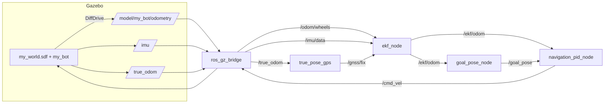

# Architecture

## Nodes

| Node | File | Rate | Role |
|---|---|---|---|
| Gazebo + bridge | `my_bot_sim/launch/sim.launch.py`, `models/my_bot/model.sdf` | IMU 100 Hz, odom 50 Hz | Physics, sensors, ROS bridge |
| `true_pose_gps` | `my_bot_sim/scripts/true_pose_gps.py` | 5 Hz | Converts the ground-truth pose + N(0, 0.3 m) noise into `NavSatFix` |
| `ekf_node` | `ugv_nav/ugv_nav/ekf_node.py` | predict 50 Hz, updates asynchronous | Fuses wheel odometry, gyro, IMU yaw, GPS |
| `navigation_pid_node` | `ugv_nav/ugv_nav/navigation_pid_node.py` | 20 Hz | Goal → `(v, ω)` |
| `goal_pose_node` | `ugv_nav/ugv_nav/goal_pose_node.py` | on demand | Keyboard goal entry, publishes `/goal_pose` |

## Why GPS is synthesised

The Gazebo NavSat sensor is defined in the model but is not bridged. `true_pose_gps` produces
`/gnss/fix` from the ground-truth pose instead, so the noise level is explicit and tunable
(`SIGMA`, `RATE` in the script). If you change `SIGMA`, change `gps_sigma` in
`ugv_nav/config/ugv_nav.yaml` too.

## Frames

* World: `+X` east, `+Y` north (ENU), `heading_deg = 0` in the world file.
* The robot spawns at the world origin with yaw 0, so the wheel-odometry `odom` frame and the
  world frame coincide at start. The EKF aligns GPS east/north to its own frame using the
  position at the moment the GPS origin is set. **Spawning with a non-zero yaw would break this alignment.**
* `/ekf/odom` has `frame_id: odom`, `child_frame_id: base_link`.
* TODO: broadcast the `odom → base_link` transform from the EKF output.

## Start-up order

All connections are message-driven, so launch order does not matter. The EKF becomes ready on
the first wheel-odometry message and then averages 20 GPS fixes (about 4 s) to set the GPS origin.
Keep the robot still until `GPS origin set. Ready for goals.` is logged.
